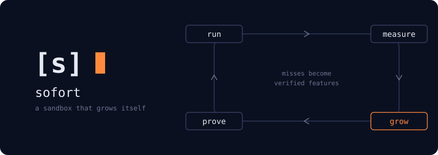
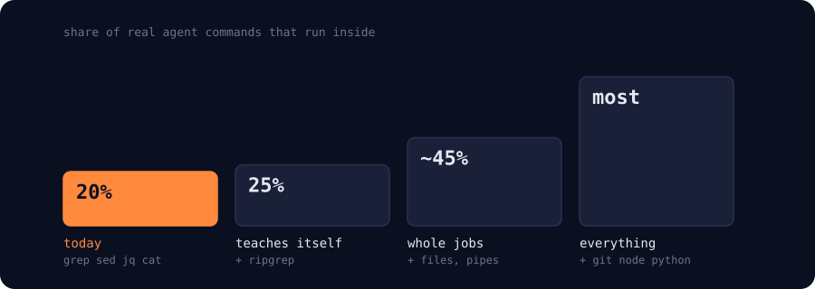

<p align="center"></p>

# Sofort

**Tiny, fast computers for AI agents, that grow themselves.**

When an agent writes code, Sofort runs it in its own small virtual machine. Each run
starts in a fraction of a millisecond and is wiped afterwards.

The machine's kernel starts out small. When agents need something it can't do yet,
another agent writes the missing piece. That piece is only accepted if it behaves
exactly like real Linux on tests the agent never saw. So Sofort gets more capable
with use, and every step is checked.

## How it works

1. **Run:** agents run code in a fresh, isolated machine.
2. **Measure:** we check which of their commands already work exactly like Linux.
3. **Grow:** for what's missing, an agent writes the new kernel feature.
4. **Prove:** real Linux decides. The feature ships only if it matches, and nothing
   that worked before breaks.

## Where it stands

- **0.13 ms** to run a small program in a fresh machine
- **100 of 100** real agent tasks pass
- **4% → 81%** of unseen test programs run exactly like Linux after the kernel grew
- **About 2 minutes** of agent work to add one kernel feature
- **1 in 5** real agent shell commands already run exactly like Linux

## What we learned

We spent about 15 research rounds testing where this could go:

- Building things is easy for agents now. **Checking them is the hard part,**
  and that is what Sofort is built around.
- For short jobs that run thousands of times, like triaging CI failures, one
  isolated machine per run is cheap: about a cent per 10,000 runs.
- To our knowledge, nobody else grows a kernel this way, with real Linux as the judge.

Details: [research summary](arch/research/RESEARCH-SUMMARY.md) ·
[experiments](arch/jitk/docs/results/README.md)

## Roadmap

<p align="center"></p>

1. **Teaches itself:** the loop runs without a person, starting with ripgrep.
2. **Whole jobs:** an agent's full task runs inside, files and pipelines included,
   with many runs sharing one machine safely.
3. **Everything:** git, Node, Python, networking. A general sandbox.

Full plan with tests and kill criteria: [ROADMAP.md](arch/jitk/docs/ROADMAP.md)

## Try it

```sh
make -C arch/jitk build test
```

Start reading at [arch/jitk/README.md](arch/jitk/README.md).
